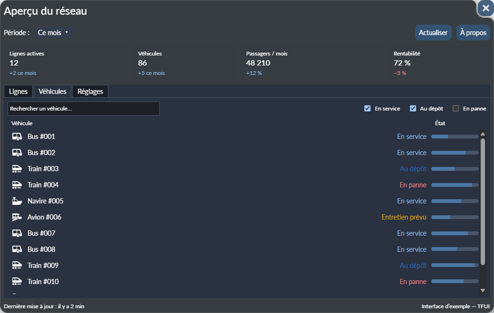
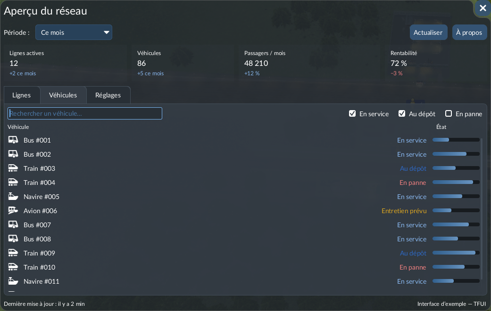

<div align="center">


# TFUI — Éditeur d’interface pour Transport Fever 3

**Concevez visuellement les fenêtres de vos mods Transport Fever 3, voyez-les sans lancer le jeu, et obtenez un Lua propre et conforme aux règles du jeu.**

<a href="README.md"> English</a> &nbsp;·&nbsp;  **Français**

### 🌐 Disponible en 6 langues

<table>
<tr>
<td align="center"><br /><sub><b>Français</b></sub></td>
<td align="center"><br /><sub><b>English</b></sub></td>
<td align="center"><br /><sub><b>Español</b></sub></td>
<td align="center"><br /><sub><b>Italiano</b></sub></td>
<td align="center"><br /><sub><b>Deutsch</b></sub></td>
<td align="center"><br /><sub><b>简体中文</b></sub></td>
</tr>
</table>

Vous pouvez vous-même ajouter une langue ou corriger une traduction, directement depuis l’application.


</div>

---

## Sommaire

- [Pourquoi TFUI ?](#pourquoi-tfui-)
- [Ce que vous pouvez en faire](#ce-que-vous-pouvez-en-faire)
- [Installation](#installation)
- [La liaison au jeu : ce qui est lu, et pourquoi](#la-liaison-au-jeu--ce-qui-est-lu-et-pourquoi)
- [Versionnez votre mod](#versionnez-votre-mod)
- [Utiliser l’éditeur](#utiliser-léditeur)
- [Mod d’exemple](#mod-dexemple)
- [Contribuer](#contribuer)
- [Développement](#développement)
- [Avertissement](#avertissement)

---

## Pourquoi TFUI ?

Les interfaces de Transport Fever 3 s’écrivent en Lua, avec le framework d’interface du jeu inspiré de React (`builtin.BoxLayout { … }`, feuilles de style `.css.lua`…). Créer la fenêtre d’un mod pose deux problèmes :

- **On ne voit pas ce qu’on construit sans lancer le jeu.** Chaque changement de marge, d’alignement ou de couleur oblige à modifier le Lua, recharger, rouvrir la fenêtre. Placer une dizaine d’éléments prend des heures.
- **Les règles ne sont écrites nulle part.** Quel composant accepte quel enfant, quelles propriétés de style existent, comment fonctionne l’étirement, ce qui fait planter toute l’interface : on l’apprend par essais et erreurs.

TFUI est né parce que je me suis heurté à ces deux murs : j’ai d’abord essayé de créer un mod à la main, et j’ai passé plus de temps à relancer le jeu qu’à concevoir ma fenêtre. J’ai donc construit l’outil qui me manquait.

## Ce que vous pouvez en faire

- **Construire des fenêtres visuellement** : glissez les composants de la palette dans l’arbre ou directement dans l’aperçu, réordonnez, enveloppez, dupliquez, renommez.
- **Voir le résultat immédiatement**, dans un aperçu qui utilise les feuilles de style de base, les polices, les couleurs et les images du jeu, aux résolutions et tailles de texte proposées par le jeu.
- **Styler comme le jeu** : classes partagées, style par élément et états survol / clic / désactivé, avec uniquement les propriétés que le jeu utilise réellement pour chaque composant.
- **Générer un mod prêt à installer** : `*.script.lua`, `*.css.lua`, `*.res.lua`, un bouton du menu principal qui ouvre votre fenêtre, et un fichier `*.handlers.lua` qui reste le vôtre pour votre code.
- **Détecter les erreurs avant le jeu** : un validateur applique des règles vérifiées en jeu (layouts refusés par le moteur, couleurs de palette inconnues, valeurs sans effet…), et un banc de test Lua exécute votre interface générée sur le vrai runtime React du jeu, sans lancer le jeu.
- **Construire, installer, tester** : écrire le mod, l’installer dans le dossier des mods locaux du jeu, lancer le jeu, relire son journal dans l’éditeur.
- **Exporter en PNG** une fenêtre (seule, ou sur un écran simulé) pour la page de votre mod.

<table>
<tr>
<td width="50%"></td>
<td width="50%"></td>
</tr>
<tr>
<td align="center"><sub>Dans l’éditeur</sub></td>
<td align="center"><sub>Dans le jeu</sub></td>
</tr>
</table>

## Installation

TFUI est une application de bureau pour **Windows**, construite avec [Tauri 2](https://tauri.app/) (Rust) et React. Il n’y a pas encore d’installeur : on la construit depuis les sources.

### Prérequis

| Outil | Version | Remarques |
|---|---|---|
| [Transport Fever 3](https://www.transportfever3.com/) | installé | L’éditeur lit ses fichiers (voir plus bas). |
| [Node.js](https://nodejs.org/) | 22 ou plus | |
| [pnpm](https://pnpm.io/) | 9 ou plus | `npm install -g pnpm` |
| [Rust](https://rustup.rs/) | stable | |
| Prérequis Tauri | — | Microsoft C++ Build Tools et WebView2 : voir le [guide Tauri](https://tauri.app/start/prerequisites/). |

### Construire et lancer

```bash
git clone https://github.com/Spit8/TFUI.git
cd TFUI
pnpm install
pnpm tauri:dev          # lancer l’éditeur
pnpm tauri build        # ou construire un installeur (src-tauri/target/release/bundle)
```

### Premier lancement

1. **Liez le jeu.** TFUI cherche Transport Fever 3 dans les dossiers Steam habituels. S’il ne le trouve pas, indiquez le dossier du jeu (celui qui contient `base/`).
2. **Importez le contenu du jeu.** Choisissez la quantité d’images à importer :
   - *Minimum* : polices et images nécessaires à l’aperçu (le plus rapide) ;
   - *Toutes les images d’interface* : toutes les icônes de l’interface du jeu, disponibles dans le panneau **Icônes du jeu** ;
   - *Toutes les images du jeu* : aussi les missions, climats, mécaniques…

   Les images ne sont converties qu’une fois ; vous pouvez réimporter à tout moment (**Outils › Importer le contenu du jeu…**).
3. **Renseignez le dossier staging** dans **Outils › Paramètres…** : le dossier des mods locaux du jeu (`…\local\staging_area`). C’est là que **Installer** copie votre mod.
4. Créez votre mod avec **Fichier › Nouveau mod…**, ou ouvrez un projet existant.

## La liaison au jeu : ce qui est lu, et pourquoi

TFUI n’embarque aucun fichier du jeu : il les lit depuis **votre** installation. Il correspond ainsi toujours à votre version du jeu, et rien qui appartient au studio n’est redistribué.

| Quoi | Où | Pour quoi faire |
|---|---|---|
| Définitions de types Teal (`builtin.d.tl`, `react.d.tl`…) | `base/tealdef`, `api/tealdef` | La liste des composants, leurs propriétés, emplacements et énumérations. Rien n’est codé en dur. |
| Feuilles de style de base (`*.css.lua`) | `base/content/*.zip` | L’apparence par défaut de chaque composant, exécutée avec le `stylesheetutil.lua` du jeu ; la liste des propriétés de style et des classes. |
| Palette de couleurs, tailles de texte, résolutions d’écran | `base/content/gui.zip` | Couleurs nommées (`colorDefault.*`), texte *petit / moyen / grand*, formats d’écran de l’aperçu. |
| Polices et images `.tga` | `base/content/*.zip` | Textes et images fidèles dans l’aperçu ; le panneau **Icônes du jeu**. |
| Runtime React (`react.lua`, `builtin.lua`) | `base/content/gui.zip` | Le banc de test Lua y exécute votre code généré. |
| Votre `settings.lua` et le journal du jeu | dossier `local` du jeu | Votre taille de texte ; les erreurs de votre mod après un essai en jeu. |

Tout ce qui est tiré du jeu (catalogue des composants, images converties) est rangé dans le dossier de données de l’application (`%APPDATA%\com.tf3.uidesigner`), **jamais dans votre mod ni dans votre projet**. Après une mise à jour du jeu, TFUI détecte la nouvelle version et propose de réimporter.

## Versionnez votre mod

**Mettez votre mod sous gestion de versions (Git, ou au minimum des sauvegardes régulières).** TFUI écrit des fichiers à votre place, et plusieurs choses peuvent les écraser :

- **Les fichiers générés sont réécrits** à chaque écriture (`*.script.lua`, `*.css.lua`, `*.res.lua`). Ils portent la mention *« fichier régénéré, ne pas modifier »* : toute modification à la main y est perdue. Votre code va dans `*.handlers.lua`, que TFUI crée une seule fois et n’écrase jamais.
- **Installer copie le mod dans le dossier staging du jeu.** TFUI demande avant de remplacer des fichiers modifiés à la main dans le staging, mais un mauvais clic suffit.
- **Les mises à jour du jeu changent les règles.** Une nouvelle version du jeu peut modifier des composants ou des styles ; réimporter met le catalogue à jour, et la prochaine écriture peut produire un Lua différent.
- **Les erreurs arrivent** : une fenêtre supprimée, un mauvais déplacement dans l’arbre… L’annulation couvre la session, Git couvre le reste.

Un commit avant chaque **Installer** permet de comparer, de revenir en arrière et de voir exactement ce que l’éditeur a changé.

## Utiliser l’éditeur

### L’espace de travail

- **Arbre** : la hiérarchie de l’écran courant ; glissez pour réordonner, clic droit pour les actions (envelopper, retirer le parent, dupliquer, masquer, verrouiller, voir le code généré).
- **Palette** : tous les composants du jeu, par catégorie, avec des motifs prêts à l’emploi (espaceurs horizontal et vertical construits exactement comme ceux du jeu).
- **Aperçu** : la fenêtre sur un écran simulé, avec zoom, résolutions issues du jeu, capture du jeu en fond si vous le souhaitez, et contours des éléments.
- **Inspecteur** : propriétés, réglages généraux (infobulle, identifiant, actif), style, classes et état de l’élément sélectionné, avec des notes sur ce qui a été vérifié en jeu.
- **Code** : le Lua généré, synchronisé avec la sélection.
- **Problèmes** : erreurs et avertissements du validateur, vérifications Teal, résultat du banc de test Lua et journal du jeu.
- Panneaux **Classes partagées** et **Icônes du jeu**.

Les panneaux se réorganisent, se ferment, ou se détachent dans leur propre fenêtre.

### Les écrans

Un projet contient plusieurs **écrans** dans le même mod : des fenêtres, des recettes simples et des **boutons plugin** (le bouton du menu principal qui ouvre votre fenêtre). Un bouton peut ouvrir d’autres fenêtres du projet.

### Les réglages

| Où | Quoi |
|---|---|
| **Outils › Paramètres…** | Dossier du jeu, dossier staging, langue de l’interface, taille du texte de l’éditeur, dossier des langues. |
| **Affichage › Réglages de l’aperçu…** | Taille du texte du jeu (*comme le jeu*, petite, moyenne, grande), captures de fond par format d’écran, couleurs des contours de survol et de sélection. |
| Barre de l’aperçu | Résolution simulée, fond (uni / image / masqué), zoom, contours des éléments. |

### L’héritage des styles

Ce que vous voyez sur un élément résulte de trois couches, appliquées dans cet ordre :

1. **Les feuilles de style de base du jeu** (`builtin.css.lua`, `default.css.lua`, `font_scaling.css.lua`…) : l’apparence par défaut de chaque composant. Les valeurs qui en viennent portent le badge **jeu** dans l’inspecteur.
2. **Les classes partagées** que vous définissez dans le panneau **Classes partagées** (par exemple `BoxLayout!toolbar`), appliquées dans leur ordre. Les classes du jeu comme `primary`, `secondary`, `negative`, `font-scale-title-3` ou `horizontal-spacer` s’utilisent directement.
3. **Le style propre de l’élément**, réglé dans l’inspecteur, pour l’état normal et les états *survol*, *clic* et *désactivé*.

L’inspecteur ne propose que les propriétés de style que le jeu utilise vraiment pour chaque type de composant, et prévient quand une valeur n’aurait aucun effet en jeu.

### Les icônes du jeu

Après l’import des images d’interface (ou de toutes les images), le panneau **Icônes du jeu** liste tous les `.tga` de l’interface du jeu, par dossier, avec une recherche. Glissez une icône dans l’aperçu ou l’arbre pour créer un `ImageView` qui la référence. Les masques gris sont teintés par la couleur du style, comme en jeu. Les images restent sur votre ordinateur : le mod ne contient que le chemin du jeu (`::/gui/…`).

<div align="center">

</div>

### Bon à savoir

- L’aperçu est une **approximation HTML/CSS** : il suit les règles mesurées en jeu et s’en approche beaucoup, mais le jeu reste la référence. Testez en jeu avant de publier.
- Certains layouts sont refusés par le moteur du jeu et font tomber **toute l’interface** (par exemple une `BoxLayout` placée directement dans un onglet ou une `List`). TFUI les enveloppe automatiquement dans un `Component`, comme le fait le jeu de base, et le validateur signale les cas restants.
- La taille d’un `ImageView` se règle avec la **propriété de style `size`**, pas avec la propriété `size` (qui décrit des données d’image brutes).

## Mod d’exemple

[`example/`](example) contient un exemple complet, en français et en anglais : un tableau de bord *Aperçu du réseau* avec barre d’outils, cartes d’indicateurs, onglets (liste et détail, recherche et liste défilante, formulaire de réglages), badge flottant et fenêtre *À propos*. Ouvrez `example/tfui_example_fr/tfui_example_fr.tfui.json` dans l’éditeur pour l’explorer.

## Contribuer

Les retours, rapports de bugs et traductions sont les bienvenus.

### Signaler un bug

[Ouvrez un ticket](https://github.com/Spit8/TFUI/issues) avec :

1. **Le journal du jeu — obligatoire.** Sans lui, un bug en jeu ne peut pas être analysé. C’est le fichier `crash_dump\stdout.txt` du dossier `local` du jeu (à côté de `staging_area`), réécrit à chaque lancement du jeu : joignez-le juste après avoir reproduit le bug. Dans l’éditeur, **Mod › Relire le journal du jeu** le lit pour vous.
2. Les étapes pour reproduire, et ce que vous attendiez.
3. Votre version de TFUI et, si possible, le projet `.tfui.json` (ou une copie réduite).
4. Une capture de l’éditeur et du jeu s’il s’agit d’une différence d’affichage.

### Améliorer les traductions

Les traductions de l’interface autres que le français ont été en grande partie produites avec une aide automatique et ont besoin de locuteurs natifs. Deux façons d’aider :

- **Directement dans l’application** : **Outils › Paramètres… › Dossier des langues…** ouvre un dossier avec un modèle (`fr.modele.json`). Copiez-le sous le nom `<code>.json` (par exemple `de.json`), traduisez les valeurs, rouvrez les paramètres : votre fichier remplace la traduction intégrée clé par clé.
- **Dans le dépôt** : modifiez `src/i18n/locales/<code>.json` et ouvrez une pull request. `pnpm i18n:check` liste les clés manquantes et les paramètres incohérents.

### Partager vos observations en jeu

Chaque fois que le jeu se comporte autrement que l’aperçu, une capture des deux est précieuse : c’est ainsi qu’ont été trouvées la plupart des règles de TFUI.

## Développement

```bash
pnpm link-game                  # lie fixtures/ à votre installation du jeu (tests, outils)
pnpm extract-catalog            # → src/catalog/catalog.generated.json
pnpm extract-style-vocabulary   # → src/catalog/style-vocabulary.generated.json
pnpm test                       # tests unitaires (Vitest) ; ceux qui dépendent du jeu demandent link-game
pnpm lint
npx tsc --noEmit
```

- `src/model`, `src/catalog`, `src/codegen` : logique pure, testée ; tout accès aux fichiers passe par les commandes Tauri (`src/tauri` → `src-tauri`).
- `src/preview` : l’aperçu HTML/CSS ; `src/verify` : le banc de test Lua (runtime du jeu exécuté avec [wasmoon](https://github.com/ceifa/wasmoon)).
- Aucun fichier du jeu n’est jamais versionné : `fixtures/` ne contient que des liens vers votre installation et est ignoré par Git.
- Tout texte visible passe par `src/i18n/locales/*.json`.

## Licence

Copyright (C) 2026 Wilfried Lambert

TFUI est un logiciel libre : vous pouvez le redistribuer et/ou le modifier selon les termes de la GNU General Public License publiée par la Free Software Foundation, soit la version 3 de la licence, soit (à votre choix) toute version ultérieure.

TFUI est distribué dans l’espoir qu’il sera utile, mais SANS AUCUNE GARANTIE, sans même la garantie implicite de QUALITÉ MARCHANDE ou d’ADÉQUATION À UN USAGE PARTICULIER. Voir la [GNU General Public License](LICENSE) (texte officiel en anglais, seul à faire foi) pour plus de détails.

## Avertissement

TFUI est un projet communautaire indépendant. Il n’est ni affilié à Urban Games ou aux éditeurs de Transport Fever 3, ni approuvé ou soutenu par eux. *Transport Fever* est une marque de ses propriétaires respectifs. TFUI ne contient ni ne redistribue aucun fichier du jeu : il les lit depuis votre propre installation.
