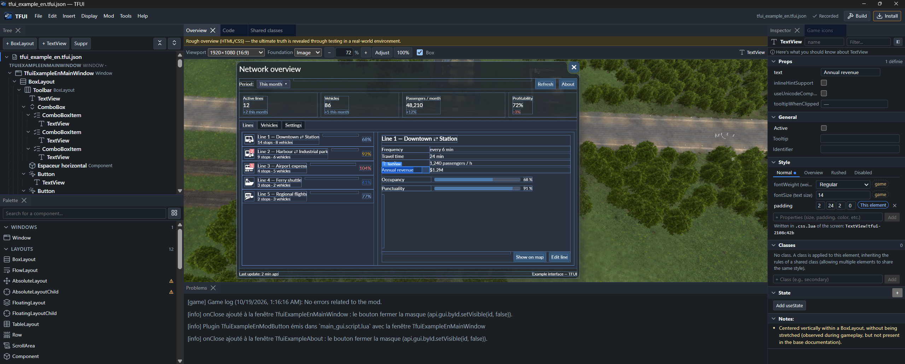
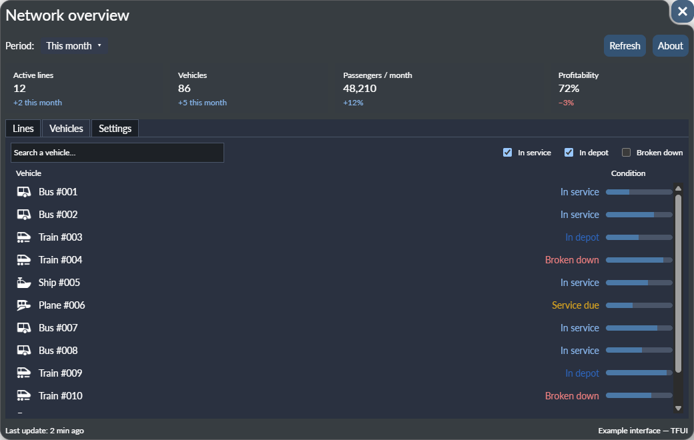
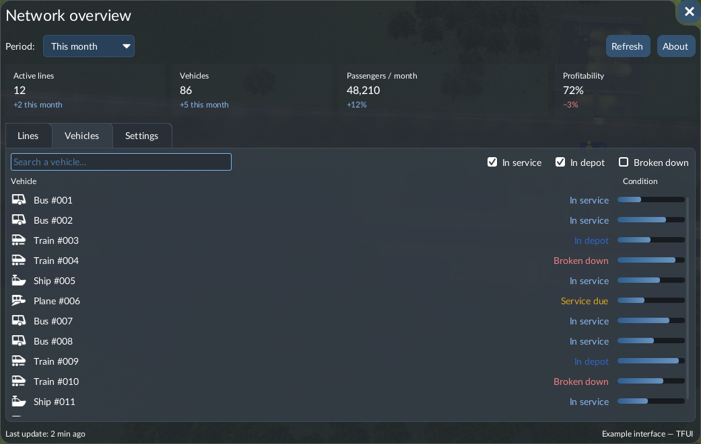
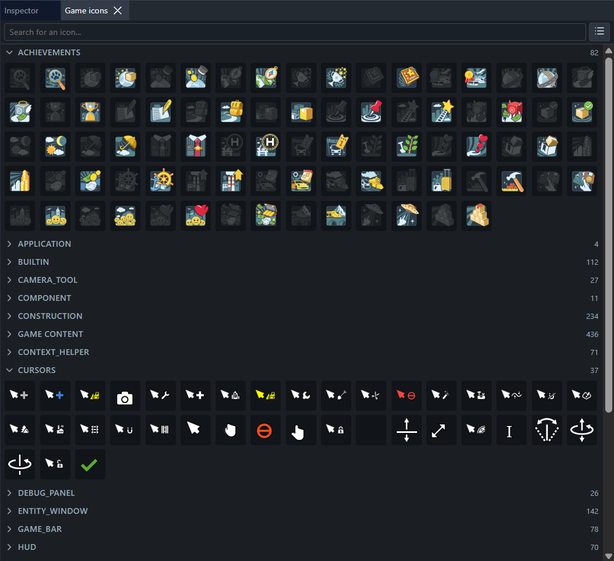

<div align="center">


# TFUI — Transport Fever 3 UI Editor

**Design Transport Fever 3 mod windows visually, see them before launching the game, and get clean, game-compliant Lua.**

<a href="https://github.com/Spit8/TFUI/releases/latest"></a>
<a href="https://mod.io/g/transportfever3/r/simply-design-tf3-mdos-ui-using-tfui-design-tool"></a>

 **English** &nbsp;·&nbsp; <a href="README.fr.md"> Français</a>

### 🌐 Available in 6 languages

<table>
<tr>
<td align="center"><br /><sub><b>English</b></sub></td>
<td align="center"><br /><sub><b>Français</b></sub></td>
<td align="center"><br /><sub><b>Español</b></sub></td>
<td align="center"><br /><sub><b>Italiano</b></sub></td>
<td align="center"><br /><sub><b>Deutsch</b></sub></td>
<td align="center"><br /><sub><b>简体中文</b></sub></td>
</tr>
</table>

You can add a language or fix a translation yourself, right from the application.



</div>

---

## Table of contents

- [Why TFUI?](#why-tfui)
- [What you can do with it](#what-you-can-do-with-it)
- [Download](#download)
- [Installation](#installation)
- [Linking the game: what is read, and why](#linking-the-game-what-is-read-and-why)
- [Version your mod](#version-your-mod)
- [Using the editor](#using-the-editor)
- [Example mod](#example-mod)
- [Contributing](#contributing)
- [Development](#development)
- [License](#license)
- [Disclaimer](#disclaimer)

---

## Why TFUI?

Transport Fever 3 interfaces are written in Lua with the game's React-like UI framework (`builtin.BoxLayout { … }`, `.css.lua` style sheets…). Making a mod window has two pain points:

- **You can't see what you build without launching the game.** Every margin, alignment or colour change means editing Lua, reloading, opening the window again. Placing a dozen elements takes hours.
- **The rules are not written anywhere.** Which component accepts which child, which style keys exist, how stretching works, what crashes the whole interface: you learn it by trial and error.

TFUI exists because I hit both walls myself: I first tried to build a mod by hand, and spent more time restarting the game than designing the window. So I built the tool I was missing.

## What you can do with it

- **Build windows visually**: drag components from the palette into a tree or straight into the preview, reorder, wrap, duplicate, rename.
- **See the result immediately** in a preview that uses the game's own base style sheets, fonts, colours and images, at the resolutions and text scaling offered by the game.
- **Style like the game does**: shared classes, per-element styles and hover / active / disabled states, with only the properties the game actually uses for each component.
- **Generate a ready-to-install mod**: `*.script.lua`, `*.css.lua`, `*.res.lua`, a main-menu button that opens your window, and a `*.handlers.lua` file that stays yours for your code.
- **Catch mistakes before the game does**: a validator encodes rules checked in game (layouts the engine refuses, unknown palette colours, values the game ignores…), and a Lua test bench runs your generated UI on the game's real React runtime without starting the game.
- **Build, install and test**: write the mod, install it into the game's local mods folder, launch the game, read its log back in the editor.
- **Export PNG** captures of a window (alone, or on a simulated screen) for your mod page.

<table>
<tr>
<td width="50%"></td>
<td width="50%"></td>
</tr>
<tr>
<td align="center"><sub>In the editor</sub></td>
<td align="center"><sub>In the game</sub></td>
</tr>
</table>

## Download

Get the latest version from the **[Releases page](https://github.com/Spit8/TFUI/releases/latest)**. New to TFUI? The **[step-by-step guide on mod.io](https://mod.io/g/transportfever3/r/simply-design-tf3-mdos-ui-using-tfui-design-tool)** walks you through your first window.

Each release contains:

| File | What it is |
|---|---|
| `TFUI_X.Y.Z_x64-setup.exe` | Installer (**recommended**) |
| `TFUI_X.Y.Z_x64.msi` | MSI installer, for managed or scripted installs |
| `TFUI_X.Y.Z_x64_portable.zip` | Portable version: `tfui.exe`, nothing to install (requires [WebView2](https://developer.microsoft.com/microsoft-edge/webview2/), already present on Windows 10/11) |
| `TFUI_X.Y.Z_sources.zip` | Source code of that version, to build it yourself (see below) |

`SHA256SUMS.txt` lists the checksums of these files. TFUI runs on **Windows** and needs **Transport Fever 3** installed: it reads the game's files (see [Linking the game](#linking-the-game-what-is-read-and-why)).

## Installation

TFUI is a desktop application for **Windows**, built with [Tauri 2](https://tauri.app/) (Rust) and React. The simplest way is the installer from the [Download](#download) section; this section explains how to build it from source.

### Prerequisites

| Tool | Version | Notes |
|---|---|---|
| [Transport Fever 3](https://www.transportfever3.com/) | installed | The editor reads its files (see below). |
| [Node.js](https://nodejs.org/) | 22 or later | |
| [pnpm](https://pnpm.io/) | 9 or later | `npm install -g pnpm` |
| [Rust](https://rustup.rs/) | stable | |
| Tauri prerequisites | — | Microsoft C++ Build Tools and WebView2: see the [Tauri guide](https://tauri.app/start/prerequisites/). |

### Build and run

```bash
git clone https://github.com/Spit8/TFUI.git
cd TFUI
pnpm install
pnpm tauri:dev          # run the editor
pnpm tauri build        # or build an installer (src-tauri/target/release/bundle)
```

### First launch

1. **Link the game.** TFUI looks for Transport Fever 3 in the usual Steam folders. If it doesn't find it, browse to the game folder (the one that contains `base/`).
2. **Import the game content.** Choose how many images to import:
   - *Minimum*: fonts and the images the preview needs (fastest);
   - *All UI images*: every icon of the game interface, available in the **Game icons** panel;
   - *All game images*: also missions, climates, mechanics…

   Images are converted once; you can import again at any time (**Tools › Import the game content…**).
3. **Set the staging folder** in **Tools › Settings…**: the game's local mods folder (`…\local\staging_area`). This is where **Install** copies your mod.
4. Create your mod with **File › New mod…**, or open an existing project.

## Linking the game: what is read, and why

TFUI never bundles game files: it reads them from **your** installation, so it always matches your game version and nothing owned by the studio is redistributed.

| What | From | Used for |
|---|---|---|
| Teal type definitions (`builtin.d.tl`, `react.d.tl`…) | `base/tealdef`, `api/tealdef` | The list of components, their properties, slots and enumerations. Nothing is hard-coded. |
| Base style sheets (`*.css.lua`) | `base/content/*.zip` | Default look of every component, executed with the game's own `stylesheetutil.lua`; list of style keys and classes. |
| Colour palette, text scaling, screen resolutions | `base/content/gui.zip` | Named colours (`colorDefault.*`), *small / medium / large* text, screen formats of the preview. |
| Fonts and `.tga` images | `base/content/*.zip` | Faithful text and images in the preview; the **Game icons** panel. |
| React runtime (`react.lua`, `builtin.lua`) | `base/content/gui.zip` | The Lua test bench runs your generated code on it. |
| Your `settings.lua` and the game log | the game's `local` folder | Your text scaling; errors of your mod after a test in game. |

Everything derived from the game (component catalog, converted images) is stored in the application data folder (`%APPDATA%\com.tf3.uidesigner`), **never in your mod or project**. After a game update, TFUI notices the new version and offers to import again.

## Version your mod

**Put your mod under version control (Git, or at least regular backups).** TFUI writes files for you, and several things can overwrite them:

- **Generated files are rewritten** on every write (`*.script.lua`, `*.css.lua`, `*.res.lua`). They are marked *“regenerated file, do not edit”*: any change you make there by hand is lost. Your code belongs in `*.handlers.lua`, which TFUI creates once and never overwrites.
- **Install copies the mod into the game's staging folder.** TFUI asks before replacing files changed by hand in the staging folder, but a wrong click is enough.
- **Game updates change the rules.** A new game version can change components or styles; re-importing updates the catalog and the next write may produce different Lua.
- **Mistakes happen**: a deleted window, a wrong move in the tree… Undo covers the session, Git covers the rest.

A commit before each **Install** lets you compare, roll back, and see exactly what the editor changed.

## Using the editor

### Workspace

- **Tree**: the hierarchy of the current screen; drag to reorder, right-click for actions (wrap, unwrap, duplicate, hide, lock, show the generated code).
- **Palette**: every component of the game, grouped by category, with ready-made patterns (horizontal / vertical spacers built exactly like the game's own).
- **Preview**: the window on a simulated screen, with zoom, screen resolutions taken from the game, an optional in-game screenshot as background, and element outlines.
- **Inspector**: properties, general settings (tooltip, identifier, enabled), style, classes and state of the selected element, with notes on what was verified in game.
- **Code**: the generated Lua, kept in sync with the selection.
- **Problems**: validation errors and warnings, Teal checks, the result of the Lua test bench and the game log.
- **Shared classes** and **Game icons** panels.

Panels can be rearranged, closed, or detached into their own window.

### Screens

A project holds several **screens** in the same mod: windows, plain recipes, and **plugin buttons** (the main-menu button that opens your window). Buttons can open other windows of the project.

### Settings

| Where | What |
|---|---|
| **Tools › Settings…** | Game folder, staging folder, interface language, text size of the editor, languages folder. |
| **Display › Preview settings…** | Game text scaling (*as the game*, small, medium, large), background screenshots per screen format, colours of the hover / selection outlines. |
| Preview toolbar | Simulated resolution, background (solid / image / hidden), zoom, element outlines. |

### How styles are inherited

What you see on an element is the result of three layers, applied in this order:

1. **The game's base style sheets** (`builtin.css.lua`, `default.css.lua`, `font_scaling.css.lua`…): the default look of every component. Values coming from them are tagged **game** in the inspector.
2. **Shared classes** you define in the **Shared classes** panel (for example `BoxLayout!toolbar`), applied in their order. Game classes such as `primary`, `secondary`, `negative`, `font-scale-title-3` or `horizontal-spacer` can be used directly.
3. **The element's own style**, edited in the inspector, for the normal state and the *hover*, *active* and *disabled* states.

The inspector only offers the style properties the game actually uses for each kind of component, and warns when a value would have no effect in game.

### Game icons

After importing the UI images (or all images), the **Game icons** panel lists every `.tga` of the game interface, grouped by folder, with a search field. Drag an icon into the preview or the tree to create an `ImageView` that points to it. Grey masks are tinted by the style colour, as in game. The images stay on your computer: the mod only references the game's path (`::/gui/…`).

<div align="center">

</div>

### Good to know

- The preview is an **HTML/CSS approximation**: it follows the rules measured in game and gets very close, but the game remains the reference. Test in game before publishing.
- Some layouts are refused by the game engine and bring the **whole interface** down (for example a `BoxLayout` directly inside a tab or a `List`). TFUI wraps them automatically in a `Component`, as the base game does, and the validator flags the remaining cases.
- `ImageView` size is set by the **`size` style property**, not by the `size` property (which describes raw image data).

## Example mod

[`example/`](example) contains a complete example, in English and French: a *Network overview* dashboard with a toolbar, indicator cards, tabs (list and details, search and scrolling list, settings form), a floating badge and an *About* window. Open `example/tfui_example_en/tfui_example_en.tfui.json` in the editor to explore it.

## Contributing

Feedback, bug reports and translations are very welcome.

### Report a bug

[Open an issue](https://github.com/Spit8/TFUI/issues) with:

1. **The game log — mandatory.** Without it, a bug in game cannot be analysed. It is the file `crash_dump\stdout.txt` in the game's `local` folder (next to `staging_area`), written again at each game start: attach it right after reproducing the bug. In the editor, **Mod › Review the game's log** reads it for you.
2. The steps to reproduce, and what you expected.
3. Your TFUI version and, if you can, the `.tfui.json` project (or a reduced copy).
4. A screenshot of the editor and of the game when it is a display difference.

### Improve the translations

The interface translations other than French were largely machine-assisted and need native speakers. Two ways to help:

- **Directly in the application**: **Tools › Settings… › Languages folder** opens a folder with a template (`fr.modele.json`). Copy it as `<code>.json` (for example `de.json`), translate the values, reopen the settings: your file overrides the built-in translation key by key.
- **In the repository**: edit `src/i18n/locales/<code>.json` and open a pull request. `pnpm i18n:check` lists missing keys and inconsistent placeholders.

### Share what you find in game

Whenever the game behaves differently from the preview, a screenshot of both is precious: this is how most of TFUI's rules were found.

## Development

```bash
pnpm link-game                  # link fixtures/ to your game installation (tests, tools)
pnpm extract-catalog            # → src/catalog/catalog.generated.json
pnpm extract-style-vocabulary   # → src/catalog/style-vocabulary.generated.json
pnpm test                       # unit tests (Vitest); game-dependent tests need link-game
pnpm lint
npx tsc --noEmit
```

- `src/model`, `src/catalog`, `src/codegen`: pure logic, unit-tested; all file access goes through Tauri commands (`src/tauri` → `src-tauri`).
- `src/preview`: the HTML/CSS preview; `src/verify`: the Lua test bench (game runtime run with [wasmoon](https://github.com/ceifa/wasmoon)).
- No game file is ever committed: `fixtures/` only contains links to your installation and is ignored by Git.
- Every visible text goes through `src/i18n/locales/*.json`.

## License

Copyright (C) 2026 Wilfried Lambert

TFUI is free software: you can redistribute it and/or modify it under the terms of the GNU General Public License as published by the Free Software Foundation, either version 3 of the License, or (at your option) any later version.

TFUI is distributed in the hope that it will be useful, but WITHOUT ANY WARRANTY; without even the implied warranty of MERCHANTABILITY or FITNESS FOR A PARTICULAR PURPOSE. See the [GNU General Public License](LICENSE) for more details.

## Disclaimer

TFUI is an independent community project. It is not affiliated with, endorsed or supported by Urban Games or the publishers of Transport Fever 3. *Transport Fever* is a trademark of its respective owners. TFUI does not contain or redistribute any game file: it reads them from your own installation.
